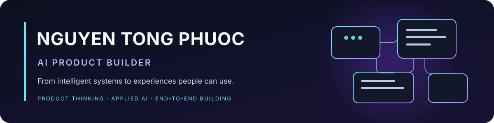

  

  **I turn AI ideas into usable products.**

  [GitHub](https://github.com/phuocntme) · [Email](mailto:contact.phuocnguyen@gmail.com) · Ho Chi Minh City, Vietnam

---

## Products & experiments

<table>
<tr>
<td width="50%" valign="top">

### ♟️ Play Caro against AI
A browser-playable 15×15 Caro game powered by an AlphaZero-style model. Choose local 1-vs-1 or challenge the AI; no install required. Online multiplayer stays in the self-hosted version.

**[▶ Play now](https://phuocntme.github.io/caro-gomoku-ai/)** · [How it works](https://github.com/phuocntme/caro-gomoku-ai)

</td>
<td width="50%" valign="top">

### 🪪 AIDA — Agent Identity on Avalanche
An on-chain product experiment for agent identity, reputation, and validation. Includes a local demo flow and an Avalanche Fuji deployment.

[Explore AIDA →](https://github.com/phuocntme/AIDA)

</td>
</tr>
<tr>
<td width="50%" valign="top">

### 🔎 Welding Surface Defect Studio
YOLO + SAM assist polygon annotation in Label Studio. A practical computer-vision workflow from detection to human-reviewed masks.

[Explore the project →](https://github.com/phuocntme/resistance-spot-welding-surface-defect)

</td>
<td width="50%" valign="top">

### 🎨 ComicBookGenerator
A prompt-to-comic pipeline and FastAPI studio that turns story ideas into illustrated panels and composed pages.

[Explore the project →](https://github.com/phuocntme/comic-book-generator)

</td>
</tr>
</table>

## How I build

I care about the whole product loop: understand the user problem, shape the interaction, connect the model and backend, then make the result easy to try and evaluate.

**Current interests:** applied AI · computer vision · agentic systems · creative tools

**Tools:** `Python` `PyTorch` `YOLO` `SAM` `FastAPI` `Docker` `TypeScript` `Solidity` `LangGraph`

---

**Building something with AI?** [Let’s talk](mailto:contact.phuocnguyen@gmail.com).
